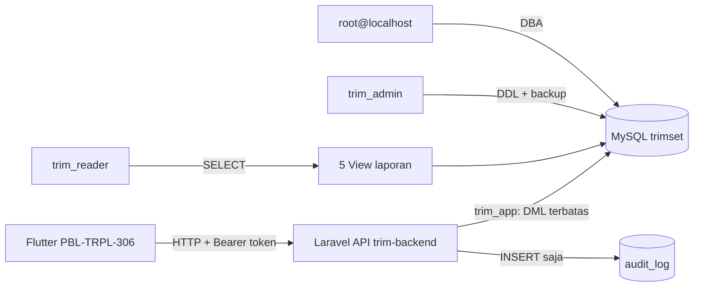

# PANDUAN 20 LUARAN — SATU FILE

Semua query bukti ada di sini. Tidak perlu buka file lain.

| Item | Lokasi |
|---|---|
| Database final (import sekali) | `C:\laragon\www\trim-backend\trimset_final.sql` |
| Panduan ini | `C:\laragon\www\trim-backend\PANDUAN_20_LUARAN.md` |
| Backend Laravel | `C:\laragon\www\trim-backend` |
| Aplikasi Flutter | `C:\laragon\www\PBL-TRPL-306` |

> `trimset_final.sql` = **`trimset.sql` + akun DB + grant + audit_log + 5 view + data + enkripsi**.
> Jadi semua 20 luaran bisa dibuktikan dari satu file itu.

---

## 0. Persiapan (sekali saja)

```powershell
# 1. Start MySQL di Laragon (Start All)

# 2. Tentukan client mysql Laragon
cd C:\laragon\www\trim-backend
$mysql = 'C:\laragon\bin\mysql\mysql-8.4.3-winx64\bin\mysql.exe'

# 3. Import database final (sekali saja)
& $mysql -u root -e "source C:/laragon/www/trim-backend/trimset_final.sql"

# 4. Masuk ke MySQL
& $mysql -u root
```

Di dalam MySQL, jalankan sekali:

```sql
USE trimset;
```

> **PENTING:** semua perintah SQL di bawah dijalankan **sebagai root**
> (`& $mysql -u root`), kecuali bagian 06 yang memakai `trim_app` / `trim_reader`.

---

## 01 — Security Scope & Data Asset Identification

**Evidence minimal:** tabel aset data + klasifikasi C/I/A.

```sql
-- daftar objek database (bukti inventaris)
SELECT table_name AS objek, table_type AS tipe, table_rows AS baris
FROM information_schema.tables
WHERE table_schema = 'trimset'
ORDER BY table_type, table_name;
```

**Hasil:** **17 base table + 5 view**.

**Tabel aset data — sengaja SEMUA tabel (tempel ini ke laporan):**

| No | Tabel | Isi / kolom penting | Data sensitif | Klasifikasi | C | I | A | Diakses oleh |
|---:|---|---|---|---|---|---|---|---|
| 1 | `antrian` | id_warga, id_jadwal, no_antrian, status | nomor antrean warga | Internal | Rendah | Sedang | Sedang | `trim_app` (S/I/U) |
| 2 | `audit_log` | actor_user_id, action, object_type, object_id, old_values, new_values, result, created_at | jejak aktivitas (PII diredaksi) | Restricted | Tinggi | Tinggi | Sedang | `trim_app` (I), `trim_admin` |
| 3 | `detail_transaksi` | id_kategori, berat, harga_per_kg, subtotal | harga & subtotal | Restricted | Rendah | Tinggi | Sedang | `trim_app` (S/I) |
| 4 | `jadwal_pencairan` | tanggal_pencairan, batas_pendaftaran, kuota, status | kuota pencairan | Internal | Rendah | Sedang | Sedang | `trim_app` (S/I/U) |
| 5 | `jadwal_penimbangan` | tanggal_penimbangan, waktu_mulai, waktu_selesai, kuota, status | kuota penimbangan | Internal | Rendah | Sedang | Sedang | `trim_app` (S/I/U) |
| 6 | `kategori_sampah` | nama_kategori, harga_per_kg, status | harga acuan | Public/Internal | Rendah | Sedang | Rendah | `trim_app` (S/I/U) |
| 7 | `migrations` | migration, batch | — | Internal | Rendah | Rendah | Rendah | `trim_admin` |
| 8 | `password_reset_tokens` | id_user, token, expires_at | token reset password | Restricted | Tinggi | Sedang | Rendah | `trim_admin` (app tidak diberi akses) |
| 9 | `pencairan` | id_warga, jumlah, catatan (encrypted), status | nominal & catatan | Restricted | Tinggi | Tinggi | Sedang | `trim_app` (S/I/U) |
| 10 | `pengumuman` | id_pengurus, judul, deskripsi, status | — | Public | Rendah | Sedang | Rendah | `trim_app` (S/I/U) |
| 11 | `pengurus` | id_user, nama | profil pengurus | Internal | Rendah | Sedang | Rendah | `trim_app` (S) |
| 12 | `personal_access_tokens` | tokenable, token (hash), abilities | token API | Restricted | Tinggi | Sedang | Sedang | `trim_app` (S/I/U/D) |
| 13 | `saldo` | id_warga, saldo_terakhir | saldo warga | Restricted | Tinggi | Tinggi | Sedang | `trim_app` (S) |
| 14 | `transaksi_penimbangan` | id_antrian, total_berat, total_nilai, status | nilai rupiah | Restricted | Sedang | Tinggi | Sedang | `trim_app` (S/I/U) |
| 15 | `ubs` | id_user, nama | profil UBS | Internal | Rendah | Sedang | Rendah | `trim_app` (S) |
| 16 | `users` | username, password (hash), role, status | kredensial & role | Restricted | Tinggi | Tinggi | Tinggi | `trim_app` (S/I) |
| 17 | `warga` | nama, no_hp, alamat (encrypted), status_verifikasi | **PII** | Confidential | Tinggi | Sedang | Sedang | `trim_app` (S/I/U) |

Keterangan akses: **S** = SELECT, **I** = INSERT, **U** = UPDATE, **D** = DELETE.

**Objek turunan — 5 view (bukan aset terpisah):**

| View | Isi | Akses |
|---|---|---|
| `v_warga_publik` | warga dengan `no_hp` **dimasking** | `trim_reader`, `trim_admin` |
| `v_kategori_aktif` | kategori berstatus aktif + harga | `trim_reader` |
| `v_transaksi_ringkas` | transaksi + nama warga + jumlah item | `trim_reader` |
| `v_pencairan_ringkas` | pencairan + nama warga + jadwal | `trim_reader` |
| `v_rekap_kas` | rekap pemasukan/pengeluaran per bulan | `trim_reader` |

**Arti klasifikasi:**
- **Public** — boleh diketahui publik (pengumuman, harga kategori).
- **Internal** — operasional, bukan rahasia.
- **Confidential** — PII (nama, no HP, alamat).
- **Restricted** — kredensial, finansial, atau jejak audit.

**Arti C/I/A:**
- **C** = dampak jika bocor, **I** = dampak jika diubah tanpa izin,
  **A** = dampak jika data tidak tersedia.

> Kenapa semua tabel? Supaya terlihat inventaris **utuh** dan tidak ada tabel
> yang "disembunyikan". `migrations` dan `password_reset_tokens` tetap masuk
> dengan klasifikasi rendah/terbatas, walaupun aplikasi tidak mengaksesnya.
> View tidak dihitung sebagai aset baru karena datanya berasal dari tabel dasar.

---

## 02 — Arsitektur Akses Basis Data

**Evidence minimal:** diagram arsitektur + trust/access boundary.



Versi teks (kalau diagram tidak bisa dirender):

```text
Flutter (PBL-TRPL-306)
   | HTTP + token (tidak pernah konek MySQL)
   v
Laravel API (trim-backend)  -- trim_app -->  MySQL trimset (17 tabel, 18 trigger)
   |                                              ^
   +---------------- INSERT only --> audit_log    |
                                                  |
trim_reader -- SELECT --> 5 View -----------------+
trim_admin  -- DDL/backup --> MySQL
root        -- DBA lingkungan --> MySQL
```

**Query bukti identitas koneksi:**

```sql
SELECT USER() AS login, CURRENT_USER() AS akun_efektif,
       @@hostname AS host_mysql, @@port AS port, DATABASE() AS db;
```

**Hasil:** `root@localhost`, host `DESKTOP-...`, port `3306`, db `trimset`.

**Trust boundary (tempel 3 poin ini):**
1. Flutter tidak membuka koneksi MySQL; semua lewat REST API + validasi Laravel.
2. Aplikasi memakai `trim_app` (DML terbatas), bukan `root`.
3. `trim_reader` hanya view; `trim_admin` hanya untuk DDL/backup.

---

## 03 — Pemisahan Database Account

**Evidence minimal:** daftar account + konfigurasi connection.

```sql
SELECT user AS akun, host, plugin,
       account_locked AS terkunci,
       (authentication_string <> '') AS punya_password
FROM mysql.user
WHERE user IN ('root','trim_admin','trim_app','trim_reader')
ORDER BY user;
```

**Hasil:** 4 baris — `root`, `trim_admin`, `trim_app`, `trim_reader`,
semua host `localhost`, `punya_password = 1` (kecuali root lokal).

**Bukti Laravel memakai `trim_app`** (PowerShell):

```powershell
Select-String -Path C:\laragon\www\trim-backend\.env -Pattern '^DB_USERNAME='
```

**Hasil:** `DB_USERNAME=trim_app`.

---

## 04 — Access Control Matrix

**Evidence minimal:** User–Role–Privilege Matrix.

```sql
-- a) privilege level database
SELECT grantee AS akun, privilege_type AS privilege
FROM information_schema.schema_privileges
WHERE table_schema = 'trimset'
ORDER BY grantee, privilege_type;

-- b) privilege level tabel & view (matriks utama)
SELECT grantee AS akun, table_name AS objek,
       GROUP_CONCAT(DISTINCT privilege_type ORDER BY privilege_type) AS privileges
FROM information_schema.table_privileges
WHERE table_schema = 'trimset'
GROUP BY grantee, table_name
ORDER BY grantee, table_name;
```

**Hasil:**
- (a) `trim_admin` → `ALL PRIVILEGES` pada `trimset`.
- (b) `trim_app` → SELECT/INSERT/UPDATE per tabel (tanpa DDL, tanpa `saldo` UPDATE).
- (b) `trim_reader` → SELECT pada 5 view saja.

**Matriks ringkas untuk laporan:**

| Objek | `trim_admin` | `trim_app` | `trim_reader` | `root` |
|---|---|---|---|---|
| Tabel domain | ALL | SELECT/INSERT/UPDATE terbatas | ❌ | ALL |
| `saldo` | ALL | SELECT | ❌ | ALL |
| `audit_log` | ALL | INSERT | ❌ | ALL |
| `migrations`, `password_reset_tokens` | ALL | ❌ | ❌ | ALL |
| 5 view | SELECT | ❌ | SELECT | ALL |
| DDL (`CREATE/ALTER/DROP`) | ✅ | ❌ | ❌ | ✅ |
| `mysql.*`, `FILE`, `SUPER` | ❌ | ❌ | ❌ | ✅ |

---

## 05 — Least Privilege

**Evidence minimal:** `SHOW GRANTS` + penjelasan kebutuhan.

```sql
SHOW GRANTS FOR 'trim_admin'@'localhost';
SHOW GRANTS FOR 'trim_app'@'localhost';
SHOW GRANTS FOR 'trim_reader'@'localhost';

-- pastikan akun TRIM tidak punya privilege global berbahaya
SELECT grantee AS akun, privilege_type AS privilege
FROM information_schema.user_privileges
WHERE privilege_type IN ('FILE','PROCESS','SUPER','CREATE USER','RELOAD','SHUTDOWN')
ORDER BY grantee;
```

**Hasil:**
- `trim_app`: hanya `SELECT/INSERT/UPDATE` tabel tertentu + `INSERT` `audit_log`.
- `trim_reader`: hanya `SELECT` 5 view.
- Query terakhir: **0 baris untuk akun TRIM**.

**Penjelasan (tempel):**
`trim_app` tidak butuh DDL karena migrasi dijalankan `trim_admin`; tidak butuh
`FILE/PROCESS/SUPER` karena tidak melakukan administrasi server; `audit_log`
hanya INSERT agar aplikasi tidak bisa menghapus jejak.

---

## 06 — Allowed vs Forbidden Access Test

**Evidence minimal:** hasil allowed **berhasil** & forbidden **gagal**.

**Versi presentasi: 10 kasus** (3 allowed + 7 forbidden). Versi lengkap **35 kasus**
tetap disimpan sebagai lampiran (`docs/security/06_test_results.txt`).

| No | Jenis | Akun | Query | Hasil aktual | Status |
|---:|---|---|---|---|---|
| 1 | Allowed | `trim_app` | `SELECT COUNT(*) FROM trimset.warga;` | `2` | PASS |
| 2 | Allowed | `trim_app` | `SELECT saldo_terakhir FROM trimset.saldo;` | 2 baris | PASS |
| 3 | Allowed | `trim_reader` | `SELECT * FROM trimset.v_warga_publik;` | 2 baris, `no_hp` termask | PASS |
| 4 | Forbidden | `trim_app` | `SELECT * FROM mysql.user;` | `ERROR 1142` — SELECT ditolak | PASS |
| 5 | Forbidden | `trim_app` | `CREATE TABLE trimset.__uji (id INT);` | `ERROR 1142` — CREATE ditolak | PASS |
| 6 | Forbidden | `trim_app` | `DELETE FROM trimset.warga WHERE 1=0;` | `ERROR 1142` — DELETE ditolak | PASS |
| 7 | Forbidden | `trim_app` | `SELECT * FROM trimset.audit_log;` | `ERROR 1142` — SELECT ditolak | PASS |
| 8 | Forbidden | `trim_app` | `UPDATE trimset.saldo SET saldo_terakhir = saldo_terakhir;` | `ERROR 1142` — UPDATE ditolak | PASS |
| 9 | Forbidden | `trim_reader` | `SELECT * FROM trimset.warga;` | `ERROR 1142` — SELECT ditolak | PASS |
| 10 | Forbidden | `trim_reader` | `DELETE FROM trimset.pencairan WHERE 1=0;` | `ERROR 1142` — DELETE ditolak | PASS |

**Ringkasan:** 3 allowed + 7 forbidden = **10 PASS, 0 FAIL**.

**Kenapa query-nya aman:**
- `DELETE ... WHERE 1=0` tidak menghapus apa pun; MySQL tetap menolak **sebelum** baris dieksekusi.
- `UPDATE saldo = saldo` tidak mengubah nilai; tetap ditolak.
- `CREATE TABLE __uji` gagal, jadi tidak ada tabel yang terbuat.
- Tidak ada `DROP` tabel asli.

**Jalankan sekaligus** (PowerShell — keluar 10 baris PASS/FAIL):

```powershell
cd C:\laragon\www\trim-backend
$mysql = 'C:\laragon\bin\mysql\mysql-8.4.3-winx64\bin\mysql.exe'
$c = Get-Content .\storage\security\credentials.local.json -Raw | ConvertFrom-Json

$tests = @(
  @{a='trim_app';    p=$c.app;    q='SELECT COUNT(*) FROM trimset.warga;';                       exp=0},
  @{a='trim_app';    p=$c.app;    q='SELECT saldo_terakhir FROM trimset.saldo;';                 exp=0},
  @{a='trim_reader'; p=$c.reader; q='SELECT * FROM trimset.v_warga_publik;';                     exp=0},
  @{a='trim_app';    p=$c.app;    q='SELECT * FROM mysql.user;';                                 exp=1},
  @{a='trim_app';    p=$c.app;    q='CREATE TABLE trimset.__uji (id INT);';                      exp=1},
  @{a='trim_app';    p=$c.app;    q='DELETE FROM trimset.warga WHERE 1=0;';                      exp=1},
  @{a='trim_app';    p=$c.app;    q='SELECT * FROM trimset.audit_log;';                          exp=1},
  @{a='trim_app';    p=$c.app;    q='UPDATE trimset.saldo SET saldo_terakhir = saldo_terakhir;'; exp=1},
  @{a='trim_reader'; p=$c.reader; q='SELECT * FROM trimset.warga;';                              exp=1},
  @{a='trim_reader'; p=$c.reader; q='DELETE FROM trimset.pencairan WHERE 1=0;';                  exp=1}
)

$i = 0
foreach ($t in $tests) {
  $i++
  $env:MYSQL_PWD = $t.p
  $null = & $mysql -u $t.a -e $t.q 2>&1
  $ok = ($LASTEXITCODE -eq $t.exp)
  "{0,2}. {1} [{2}] {3}" -f $i, ($(if ($ok) {'PASS'} else {'FAIL'})), $t.a, $t.q
}
Remove-Item Env:MYSQL_PWD
& $mysql -u root -e "DROP TABLE IF EXISTS trimset.__uji;"
```

**Untuk laporan:**
- **Slide:** tampilkan tabel 10 baris di atas.
- **Lampiran:** `06_test_results.txt` (35 kasus: 15 allowed + 20 forbidden).
- Jika ditanya kenapa slide hanya 10: *"Ini representasi per kelompok; log lengkap 35 kasus ada di lampiran."*

---

## 07 — Account dan Host Restriction

**Evidence minimal:** user, host, assessment, konfigurasi.

```sql
SELECT user AS akun, host,
       CASE WHEN host IN ('localhost','127.0.0.1') THEN 'Comply' ELSE 'Review' END AS status
FROM mysql.user
WHERE user IN ('root','trim_admin','trim_app','trim_reader')
ORDER BY user;

SELECT variable_name AS variabel, variable_value AS nilai
FROM performance_schema.global_variables
WHERE variable_name IN ('bind_address','port','skip_name_resolve','require_secure_transport')
ORDER BY variable_name;
```

**Hasil:**
- Semua akun host `localhost` → **Comply**.
- `bind_address = *` → **Not Comply** (catatan: perlu `bind-address=127.0.0.1` + restart).

**Assessment (tempel):**
| Akun | Host | Status | Catatan |
|---|---|---|---|
| root | localhost | ⚠️ | password kosong (lokal) |
| trim_admin | localhost | ✅ | hanya loopback |
| trim_app | localhost | ✅ | hanya loopback |
| trim_reader | localhost | ✅ | hanya loopback |
| akun `%` | — | ✅ tidak ada | tidak ada akses remote |

---

## 08 — Security Baseline MySQL

**Evidence minimal:** checklist Comply / Partially / Not Comply / N/A.

```sql
SELECT variable_name AS variabel, variable_value AS nilai
FROM performance_schema.global_variables
WHERE variable_name IN (
  'version','bind_address','skip_name_resolve','require_secure_transport',
  'local_infile','secure_file_priv','sql_mode','default_storage_engine',
  'log_bin','general_log','tls_version',
  'innodb_flush_log_at_trx_commit','sync_binlog'
)
ORDER BY variable_name;
```

**Checklist siap tempel (kondisi saat ini):**

| Kontrol | Nilai | Status |
|---|---|---|
| Versi MySQL | 8.4.3 | Comply |
| Storage engine | InnoDB | Comply |
| `sql_mode` | `STRICT_TRANS_TABLES,...` | Comply |
| `local_infile` | 0 | Comply |
| `general_log` | 0 | Comply |
| `log_bin` | 1 | Comply |
| `innodb_flush_log_at_trx_commit` | 1 | Comply |
| `sync_binlog` | 1 | Comply |
| TLS | TLSv1.2, TLSv1.3 | Comply |
| `bind_address` | `*` | **Not Comply** |
| `require_secure_transport` | 0 | **Not Comply** (lokal) |
| `secure_file_priv` | kosong | **Not Comply** |
| `skip_name_resolve` | 0 | Partially Comply |
| `validate_password` | belum aktif | **Not Comply** |
| password `root` | kosong | **Not Comply** |

---

## 09 — Pembatasan Data dengan View

**Evidence minimal:** `CREATE VIEW` + hasil akses + pembuktian pembatasan.

```sql
-- definisi view (bukti masking)
SHOW CREATE VIEW trimset.v_warga_publik\G

-- hasil akses view (no_hp disamarkan)
SELECT * FROM trimset.v_warga_publik;

-- tabel dasar (hanya admin yang bisa lihat penuh)
SELECT id_warga, nama, no_hp FROM trimset.warga;

-- bukti 100% termask
SELECT COUNT(*) AS total,
       SUM(no_hp_masked LIKE '%****%') AS termask,
       SUM(no_hp_masked NOT LIKE '%****%') AS terbuka
FROM trimset.v_warga_publik;
```

**Hasil:**

| Sumber | no HP |
|---|---|
| `v_warga_publik` | `0812****90` (termask) |
| `warga` (admin) | `081234567890` (penuh) |
| Query terakhir | `total=2`, `termask=2`, `terbuka=0` |

5 view: `v_warga_publik`, `v_kategori_aktif`, `v_transaksi_ringkas`,
`v_pencairan_ringkas`, `v_rekap_kas`.

---

## 10 — Perlindungan Password

**Evidence minimal:** struktur/data tersanitasi + mekanisme hashing.

```sql
SELECT id_user, username,
       LEFT(password, 7) AS awalan,
       LENGTH(password)  AS panjang,
       (password LIKE '$2y$12$%' OR password LIKE '$2b$12$%') AS bcrypt_cost12
FROM trimset.users;

-- harus 0 (tidak ada yang bukan bcrypt cost 12)
SELECT COUNT(*) AS bukan_bcrypt
FROM trimset.users
WHERE password NOT LIKE '$2y$12$%' AND password NOT LIKE '$2b$12$%';
```

**Hasil:** `awalan = $2y$12$`, `panjang = 60`, `bcrypt_cost12 = 1`,
`bukan_bcrypt = 0`.

**Mekanisme aplikasi:** `App\Models\User` memakai cast `'password' => 'hashed'`;
`.env` berisi `BCRYPT_ROUNDS=12`.

---

## 11 — Hashing dan Salting

**Evidence minimal:** bukti credential tersimpan tanpa membuka password asli.

```sql
SELECT id_user,
       SUBSTRING(password, 8, 22)  AS salt_22_char,
       SUBSTRING(password, 30, 31) AS hash_31_char,
       LENGTH(password)            AS total
FROM trimset.users;

SELECT COUNT(*) AS total_user, COUNT(DISTINCT password) AS hash_unik
FROM trimset.users;
```

**Hasil:** setiap user punya **salt berbeda**; `total=4`, `hash_unik=4`,
`total = 60` karakter.

**Demo salt acak** (opsional, PowerShell):

```powershell
php artisan tinker --execute="echo Hash::make('rahasia123'), PHP_EOL; echo Hash::make('rahasia123'), PHP_EOL;"
```

Hasilnya 2 hash **berbeda** untuk password yang sama.

---

## 12 — Encryption Data Sensitif

**Evidence minimal:** ciphertext + authorized decryption / alasan teknis.

```sql
SELECT id_warga, LEFT(alamat, 40) AS ciphertext, LENGTH(alamat) AS panjang
FROM trimset.warga;

SELECT id_pencairan, LEFT(catatan, 40) AS ciphertext, LENGTH(catatan) AS panjang
FROM trimset.pencairan;

-- harus 0 (tidak ada alamat plaintext)
SELECT COUNT(*) AS alamat_plaintext
FROM trimset.warga WHERE alamat NOT LIKE 'eyJpdiI6%';
```

**Hasil:** ciphertext `eyJpdiI6...`, panjang **228**, `alamat_plaintext = 0`.

**Authorized decryption** (PowerShell):

```powershell
php artisan tinker --execute="echo App\Models\Warga::first()->alamat, PHP_EOL;"
```

**Alasan teknis:** `warga.alamat` dan `pencairan.catatan` memakai cast
`encrypted` (AES-256-CBC + APP_KEY). `warga.no_hp` sengaja plaintext karena
dipakai login/pencarian, sehingga dilindungi **masking di view**, bukan enkripsi.

---

## 13 — Transaction

**Evidence minimal:** `START TRANSACTION`/mekanisme framework + success path.

**Bukti framework** (PowerShell):

```powershell
Select-String -Path C:\laragon\www\trim-backend\app\Http\Controllers\Api\*.php `
  -Pattern 'DB::transaction|lockForUpdate' |
  Select-Object Filename, LineNumber, Line
```

**Hasil:** `TransaksiController.php`, `DompetController.php`, `AuthController.php`.

**Bukti data berubah atomik** (satu transaksi menyentuh 3 tabel):

```sql
SELECT t.id_transaksi, a.id_warga, a.status AS status_antrian,
       t.total_berat, t.total_nilai, s.saldo_terakhir
FROM trimset.transaksi_penimbangan t
JOIN trimset.antrian a ON a.id_antrian = t.id_antrian
JOIN trimset.saldo   s ON s.id_warga   = a.id_warga
ORDER BY t.id_transaksi;
```

**Hasil:** 2 transaksi; saldo warga ikut terupdate dari trigger.

---

## 14 — COMMIT dan ROLLBACK

**Evidence minimal:** kondisi data sebelum dan sesudah dua skenario.

```sql
DROP TABLE IF EXISTS trimset.__evidence_tx__;
CREATE TABLE trimset.__evidence_tx__ (
  id INT AUTO_INCREMENT PRIMARY KEY,
  nilai INT NOT NULL
) ENGINE=InnoDB;

-- SKENARIO A: ROLLBACK
SELECT COUNT(*) AS a1_sebelum FROM trimset.__evidence_tx__;
START TRANSACTION;
INSERT INTO trimset.__evidence_tx__ (nilai) VALUES (1);
SELECT COUNT(*) AS a2_di_dalam FROM trimset.__evidence_tx__;
ROLLBACK;
SELECT COUNT(*) AS a3_setelah_rollback FROM trimset.__evidence_tx__;

-- SKENARIO B: COMMIT
START TRANSACTION;  
INSERT INTO trimset.__evidence_tx__ (nilai) VALUES (2);
SELECT COUNT(*) AS b2_di_dalam FROM trimset.__evidence_tx__;
COMMIT;
SELECT COUNT(*) AS b3_setelah_commit FROM trimset.__evidence_tx__;

DROP TABLE trimset.__evidence_tx__;
```

**Hasil:**

| Skenario | Sebelum | Di dalam | Sesudah |
|---|---|---|---|
| ROLLBACK | 0 | 1 | **0** (kembali) |
| COMMIT | 0 | 1 | **1** (permanen) |

---

## 15 — Concurrent Access / Locking

**Evidence minimal:** skenario + strategi + hasil.

**Jendela 1** (`& $mysql -u root`):

```sql
USE trimset;
START TRANSACTION;
SELECT saldo_terakhir FROM saldo WHERE id_warga = 1 FOR UPDATE;
-- biarkan terbuka, JANGAN commit
```

**Jendela 2** (`& $mysql -u root`):

```sql
USE trimset;
SET SESSION innodb_lock_wait_timeout = 2;
START TRANSACTION;
SELECT saldo_terakhir FROM saldo WHERE id_warga = 1 FOR UPDATE;
-- hasil: ERROR 1205 (HY000): Lock wait timeout exceeded
ROLLBACK;
```

Setelah itu **Jendela 1**: `ROLLBACK;`

**Monitoring** (jendela 3, root):

```sql
SELECT * FROM performance_schema.data_lock_waits;
SELECT trx_id, trx_state, trx_query FROM information_schema.innodb_trx;
```

**Penjelasan:** `SELECT ... FOR UPDATE` mengunci baris selama transaksi;
sesi lain menunggu sampai timeout, sehingga **tidak terjadi lost update**.
Aplikasi memakai `lockForUpdate()` di `TransaksiController` dan `DompetController`.

---

## 16 — Audit Trail

**Evidence minimal:** isi audit log + satu skenario; minimal actor, action,
object, timestamp, result.

**Skenario uji** (PowerShell — login gagal):

```powershell
try {
  Invoke-RestMethod -Uri 'http://127.0.0.1:3000/api/login' -Method Post `
    -ContentType 'application/json' `
    -Body '{"whatsapp":"000","password":"salah"}'
} catch {
  "Gagal login sesuai harapan: $($_.Exception.Response.StatusCode.value__)"
}
```

**Baca audit:**

```sql
SELECT id_audit, actor_user_id AS actor, actor_role AS role,
       action, object_type AS object, object_id,
       result, http_method, http_path, http_status, created_at
FROM trimset.audit_log
ORDER BY id_audit;

-- bukti redaksi PII
SELECT old_values, new_values
FROM trimset.audit_log
WHERE object_type = 'warga';
```

**Hasil:** 9+ baris; kolom actor/action/object/timestamp/result terisi.
Baris login gagal: `post api/login | failed | 422`.

---

## 17 — Backup Database

**Evidence minimal:** file backup + command + waktu.

```powershell
cd C:\laragon\www\trim-backend
powershell -ExecutionPolicy Bypass -File .\scripts\backup.ps1

Get-ChildItem .\storage\backups\trimset_*.sql |
  Sort-Object LastWriteTime -Descending |
  Select-Object -First 2 Name, Length, LastWriteTime

# metadata SHA256
Get-Content (Get-ChildItem .\storage\backups\trimset_*.sql.json |
  Sort-Object LastWriteTime -Descending |
  Select-Object -First 1).FullName
```

**Hasil:** file `trimset_<timestamp>.sql` + `.sql.json` (ukuran, SHA256,
waktu, database). Retensi 14 hari; `mysqldump --single-transaction --triggers
--routines`.

---

## 18 — Restore Verification

**Evidence minimal:** restore di database uji + verifikasi data.

```powershell
cd C:\laragon\www\trim-backend
$b = (Get-ChildItem .\storage\backups\trimset_*.sql |
      Sort-Object LastWriteTime -Descending |
      Select-Object -First 1).FullName

powershell -ExecutionPolicy Bypass -File .\scripts\restore.ps1 `
  -BackupFile $b -TargetDatabase trimset_restore_test
```

Lalu **sebagai root**:

```sql
SELECT 'users' AS tabel,
  (SELECT COUNT(*) FROM trimset.users) AS sumber,
  (SELECT COUNT(*) FROM trimset_restore_test.users) AS restore,
  (SELECT COUNT(*) FROM trimset.users) =
  (SELECT COUNT(*) FROM trimset_restore_test.users) AS sama;

SELECT 'warga' AS tabel,
  (SELECT COUNT(*) FROM trimset.warga) AS sumber,
  (SELECT COUNT(*) FROM trimset_restore_test.warga) AS restore;

SELECT 'pencairan' AS tabel,
  (SELECT COUNT(*) FROM trimset.pencairan) AS sumber,
  (SELECT COUNT(*) FROM trimset_restore_test.pencairan) AS restore;
```

**Hasil:** `sumber = restore`, `sama = 1`; ciphertext tetap terenkripsi.

Bersihkan:

```sql
DROP DATABASE trimset_restore_test;
```

> ⚠️ **Jangan** memakai `trimset_final.sql` untuk restore ke DB uji — file itu
> berisi `DROP DATABASE trimset`. Pakai hasil `backup.ps1` seperti di atas.

---

## 19 — CIA Control Mapping

**Evidence minimal:** tabel Control, Risk, CIA, Evidence, Result.

```sql
SELECT 'C1 Masking no_hp' AS control, 'Confidentiality' AS cia,
       CONCAT(SUM(no_hp_masked LIKE '%****%'), '/', COUNT(*), ' termask') AS bukti,
       CASE WHEN SUM(no_hp_masked LIKE '%****%') = COUNT(*) THEN 'PASS' ELSE 'FAIL' END AS hasil
FROM trimset.v_warga_publik
UNION ALL
SELECT 'C2 Enkripsi alamat', 'Confidentiality',
       CONCAT(SUM(alamat LIKE 'eyJpdiI6%'), '/', COUNT(*), ' ciphertext'),
       CASE WHEN SUM(alamat LIKE 'eyJpdiI6%') = COUNT(*) THEN 'PASS' ELSE 'FAIL' END
FROM trimset.warga
UNION ALL
SELECT 'C3 Bcrypt cost 12', 'Confidentiality',
       CONCAT(SUM(password LIKE '$2y$12$%' OR password LIKE '$2b$12$%'), '/', COUNT(*), ' akun'),
       CASE WHEN SUM(password LIKE '$2y$12$%' OR password LIKE '$2b$12$%') = COUNT(*) THEN 'PASS' ELSE 'FAIL' END
FROM trimset.users
UNION ALL
SELECT 'C4 Trigger bisnis', 'Integrity',
       CONCAT(COUNT(*), ' trigger'),
       CASE WHEN COUNT(*) >= 18 THEN 'PASS' ELSE 'PARTIAL' END
FROM information_schema.triggers WHERE trigger_schema = 'trimset'
UNION ALL
SELECT 'C5 Audit trail', 'Integrity',
       CONCAT(COUNT(*), ' baris audit'),
       CASE WHEN COUNT(*) > 0 THEN 'PASS' ELSE 'FAIL' END
FROM trimset.audit_log
UNION ALL
SELECT 'C6 Saldo non-negatif', 'Integrity',
       CONCAT(SUM(saldo_terakhir < 0), ' negatif / ', COUNT(*), ' saldo'),
       CASE WHEN SUM(saldo_terakhir < 0) = 0 THEN 'PASS' ELSE 'FAIL' END
FROM trimset.saldo;
```

**Hasil:** semua **PASS**.

**Tabel laporan:**

| Control | Risk | CIA | Evidence | Result |
|---|---|---|---|---|
| Masking `no_hp` | PII bocor | C | 2/2 termask | PASS |
| Enkripsi alamat | dump bocor | C | 2/2 ciphertext 228 char | PASS |
| Bcrypt cost 12 | password dipecah | C | 4/4 akun bcrypt | PASS |
| Least privilege | eskalasi akses | C | `SHOW GRANTS` tanpa DDL | PASS |
| 18 trigger | manipulasi saldo | I | 18 trigger aktif | PASS |
| FK + CHECK | data invalid | I | 17 FK, 5 CHECK | PASS |
| `FOR UPDATE` | lost update | I | ERROR 1205 saat uji | PASS |
| Audit append-only | jejak dihapus | I | app INSERT-only | PASS |
| Backup + restore | kehilangan data | A | dump + SHA256 + restore | PASS |

---

## 20 — Final Security Posture

**Evidence minimal:** temuan awal, mitigasi, hasil retest, status akhir.

```sql
SELECT 'tabel' AS metrik, COUNT(*) AS nilai
FROM information_schema.tables
WHERE table_schema='trimset' AND table_type='BASE TABLE'
UNION ALL SELECT 'view', COUNT(*) FROM information_schema.views WHERE table_schema='trimset'
UNION ALL SELECT 'trigger', COUNT(*) FROM information_schema.triggers WHERE trigger_schema='trimset'
UNION ALL SELECT 'password_plaintext', COUNT(*) FROM trimset.users
  WHERE password NOT LIKE '$2y$12$%' AND password NOT LIKE '$2b$12$%'
UNION ALL SELECT 'alamat_plaintext', COUNT(*) FROM trimset.warga
  WHERE alamat NOT LIKE 'eyJpdiI6%'
UNION ALL SELECT 'saldo_negatif', COUNT(*) FROM trimset.saldo WHERE saldo_terakhir < 0
UNION ALL SELECT 'audit', COUNT(*) FROM trimset.audit_log;
```

**Hasil:** `tabel=17`, `view=5`, `trigger=18`, `password_plaintext=0`,
`alamat_plaintext=0`, `saldo_negatif=0`, `audit=9`.

**Tabel laporan:**

| Temuan awal | Mitigasi | Hasil retest | Status |
|---|---|---|---|
| Aplikasi pakai `root` | akun `trim_app` + grant | `CURRENT_USER()=trim_app` | ✅ |
| Semua bisa baca semua | view + `trim_reader` | SELECT tabel dasar → 1142 | ✅ |
| Password plaintext | cast `hashed` + bcrypt 12 | 0 non-bcrypt | ✅ |
| PII terbaca | enkripsi + masking | 0 plaintext; 100% termask | ✅ |
| Tanpa jejak | `audit_log` + observer | 9 baris, app INSERT-only | ✅ |
| Tanpa backup | `backup.ps1` + SHA256 | dump + restore OK | ✅ |
| Root tanpa password | `ALTER USER root` | belum dijalankan | 🟡 |
| `bind_address=*` | `bind-address=127.0.0.1` + restart | belum dijalankan | 🟡 |
| `secure_file_priv` kosong | set path + restart | belum dijalankan | 🟡 |
| `validate_password` off | install component | belum dijalankan | 🟡 |
| `APP_DEBUG=true` | `APP_DEBUG=false` + HTTPS | lokal | 🟡 |

**Kesimpulan:** kontrol inti (akun terpisah, least privilege, view, enkripsi,
transaksi, audit, backup/restore) **terpasang dan teruji**; sisa item adalah
hardening server yang butuh restart/persetujuan DBA.

---

## Lampiran — ambil semua bukti sekaligus

```powershell
cd C:\laragon\www\trim-backend
powershell -ExecutionPolicy Bypass -File .\scripts\collect-evidence.ps1
```

Hasil: `docs\security\evidence_<timestamp>.txt` (berisi query 01–20 +
uji allowed/forbidden + bagian root). Contoh terakhir:
`PASS: 11`, `FAIL: 0`.


Luaran 01 — Ruang Lingkup Data (Data Assets)
- Apa yang ditampilkan: Layar terminal kueri information_schema.TABLES (muncul 17 tabel & 5 view).
- Kalimat Presentasi:  
"Di langkah pertama, kita memetakan seluruh aset data pada aplikasi TRIM. Total ada 17 tabel utama dan 5 view. Data yang paling penting kita lindungi adalah data akun pengguna, saldo tabungan sampah, catatan transaksi, serta data pribadi warga seperti nomor HP dan alamat rumah."
Luaran 02 — Arsitektur Akses Basis Data
- Apa yang ditampilkan: Diagram arsitektur (Flutter → Laravel → MySQL) atau kueri SELECT CURRENT_USER().
- Kalimat Presentasi:  
"Aplikasi HP Flutter sama sekali tidak boleh dan tidak bisa menyentuh database secara langsung. Semua harus melewati pintu perantara yaitu API Laravel. Di sisi database, Laravel kita hubungkan memakai akun khusus bernama trim_app, bukan akun root yang punya kuasa penuh."
Luaran 03 — Pemisahan Akun Basis Data
- Apa yang ditampilkan: Kueri tabel mysql.user (muncul 4 akun: root, trim_admin, trim_app, trim_reader).
- Kalimat Presentasi:  
"Di sini kita menerapkan pemisahan tugas. Akun database kita bagi menjadi empat: root hanya untuk admin server, trim_admin untuk mengelola tabel dan backup, trim_app untuk operasional aplikasi sehari-hari, dan trim_reader khusus untuk membaca laporan. Jadi tidak ada satu akun yang memegang segalanya."
Luaran 04 — Matriks Hak Akses (Access Matrix)
- Apa yang ditampilkan: Tabel matriks hak akses di panduan/slide.
- Kalimat Presentasi:  
"Ini adalah aturan siapa boleh melakukan apa. Contohnya, akun aplikasi trim_app hanya boleh menambah dan membaca data penimbangan, tapi dilarang keras mengubah saldo secara langsung atau mengacak-acak data sistem."
Luaran 05 — Prinsip Hak Akses Minimum (Least Privilege)
- Apa yang ditampilkan: Kueri SHOW GRANTS FOR 'trim_app'@'localhost';.
- Kalimat Presentasi:  
"Prinsipnya sederhana: berikan izin secukupnya saja, jangan berlebihan. Di sini terbukti akun aplikasi tidak memiliki perintah berbahaya seperti menghapus tabel (DROP) atau mengubah struktur database (ALTER). Jadi kalau aplikasi sampai diretas, peretas tetap tidak bisa merusak database kita."
Luaran 06 — Uji Akses Boleh vs Terlarang
- Apa yang ditampilkan: Skrip PowerShell 10 uji coba (muncul tulisan 10 PASS, 0 FAIL).
- Kalimat Presentasi:  
"Sekarang kita buktikan aturannya berjalan. Saat akun aplikasi menjalankan perintah normal seperti membaca data warga, hasilnya sukses (PASS). Namun ketika mencoba perintah terlarang—seperti membuat tabel baru atau membaca tabel pengguna server—MySQL langsung menolaknya secara tegas dengan pesan Error 1142 (Command denied)."
Luaran 07 — Pembatasan Asal Koneksi (Host Restriction)
- Apa yang ditampilkan: Kueri SELECT user, host FROM mysql.user (semua host tertulis localhost).
- Kalimat Presentasi:  
"Semua akun database kita kunci agar hanya bisa diakses dari komputer lokal (localhost). Artinya, orang asing dari jaringan luar atau internet tidak bisa sembarangan menembak koneksi langsung ke port database kita."
Luaran 08 — Standar Keamanan Server (Baseline MySQL)
- Apa yang ditampilkan: Kueri variabel keamanan MySQL (sql_mode, InnoDB, log_bin).
- Kalimat Presentasi:  
"Di sini kita pastikan setelan mesin MySQL sudah sesuai standar keamanan: mesin penyimpanan memakai InnoDB yang mendukung transaksi aman, aturan validasi data dibuat ketat agar tidak ada data aneh yang lolos, dan fitur pencatatan riwayat data sudah aktif."
Luaran 09 — Penyensoran Data dengan View (Data Masking)
- Apa yang ditampilkan: Perbandingan kueri tabel warga (nomor asli) vs v_warga_publik (nomor sensor 0812****90).
- Kalimat Presentasi:  
"Untuk melindungi privasi warga di laporan publik, kita buatkan jendela khusus atau view. Bisa dilihat perbandingannya: di tabel asli nomor HP tersimpan penuh, tapi saat dilihat lewat view publik, 4 digit nomor HP otomatis disensor menjadi bintang-bintang."
Luaran 10 — Pengamanan Kata Sandi (Password Hashing)
- Apa yang ditampilkan: Kueri tabel users (muncul awalan $2y$12$ dan panjang 60 karakter).
- Kalimat Presentasi:  
"Kata sandi pengguna sama sekali tidak disimpan dalam bentuk teks biasa. Semuanya diacak menggunakan algoritma standar industri yaitu Bcrypt tingkat 12 sepanjang 60 karakter. Jadi meskipun file database bocor, kata sandi aslinya tetap mustahil untuk dibaca langsung."
Luaran 11 — Pengacakan Sandi Unik (Salting)
- Apa yang ditampilkan: Kueri 22 karakter salt unik atau perbandingan 2 akun dengan password sama.
- Kalimat Presentasi:  
"Bcrypt juga otomatis menambahkan bumbu acak atau salt yang unik pada setiap akun. Buktinya, meskipun ada dua pengguna yang memakai kata sandi yang persis sama, hasil acakan di database tetap berbeda total. Ini mencegah penyerang menebak password menggunakan daftar kata sandi umum."
Luaran 12 — Enkripsi Data Sensitif (Encryption at-Rest)
- Apa yang ditampilkan: Data kolom alamat berupa ciphertext acak (eyJpdiI6...) lalu hasil dekripsi lewat Tinker.
- Kalimat Presentasi:  
"Selain kata sandi, alamat rumah warga juga kita amankan dengan enkripsi AES-256. Di dalam database, alamat tersimpan sebagai kode acak yang tidak masuk akal. Hanya sistem aplikasi resmi yang memegang kunci rahasia yang bisa menerjemahkan kode acak tersebut kembali menjadi alamat asli."
Luaran 13 — Transaksi Data Terpadu (Transaction)
- Apa yang ditampilkan: Potongan koding DB::transaction() dan hasil kueri transaksi yang terhubung ke saldo.
- Kalimat Presentasi:  
"Saat warga menimbang sampah, ada banyak tabel yang berubah bersamaan: nomor antrean selesai, data sampah dicatat, dan saldo warga bertambah. Semua proses ini kita satukan dalam satu paket transaksi, supaya semuanya berubah berbarengan secara konsisten."
Luaran 14 — Pembatalan dan Penyimpanan (COMMIT & ROLLBACK)
- Apa yang ditampilkan: Demo terminal skenario ROLLBACK (data kembali 0) dan COMMIT (data tersimpan 1).
- Kalimat Presentasi:  
"Ini pembuktian keamanan transaksinya. Jika di tengah jalan terjadi gangguan atau server mati mendadak, sistem otomatis membatalkan seluruh proses lewat ROLLBACK sehingga saldo tidak kacau. Namun jika semua tahap berhasil, barulah data disahkan dan disimpan permanen lewat COMMIT."
Luaran 15 — Pencegahan Benturan Data (Concurrency Locking)
- Apa yang ditampilkan: Jendela 1 menahan data, Jendela 2 muncul pesan ERROR 1205: Lock wait timeout.
- Kalimat Presentasi:  
"Bagaimana jika ada dua transaksi yang mencoba mengubah saldo warga yang sama di detik yang sama? Sistem kita menerapkan penguncian data. Sesi kedua dipaksa antre menunggu sampai sesi pertama selesai. Jika terlalu lama, sistem menolaknya dengan pesan Lock wait timeout, sehingga saldo tidak pernah salah hitung atau tertimpa."
Luaran 16 — Jejak Riwayat Aktivitas (Audit Trail)
- Apa yang ditampilkan: Kueri tabel audit_log (muncul 9 baris catatan riwayat).
- Kalimat Presentasi:  
"Setiap tindakan penting di sistem tercatat secara otomatis pada tabel audit log: siapa yang login, siapa yang gagal login, siapa yang mengubah data, dan kapan waktunya. Akun aplikasi pun hanya diberi izin menulis catatan baru, tidak bisa mengubah atau menghapus riwayat yang sudah ada."
Luaran 17 — Cadangan Database Otomatis (Backup)
- Apa yang ditampilkan: File trimset_....sql dan file pendamping .sql.json yang memuat kode SHA-256.
- Kalimat Presentasi:  
"Untuk mengantisipasi musibah kehilangan data, kita membuat skrip cadangan otomatis. Hasil backup-nya berupa file SQL yang dilengkapi dengan tanda sidik jari digital berupa hash SHA-256, untuk memastikan file backup tersebut asli dan belum pernah diubah-ubah oleh pihak lain."
Luaran 18 — Uji Coba Pemulihan Data (Restore Verification)
- Apa yang ditampilkan: Output pemulihan ke database uji trimset_restore_test yang bernilai sama = 1.
- Kalimat Presentasi:  
"Punya file cadangan saja tidak cukup, kita harus membuktikan datanya benar-benar bisa dipulihkan. Di sini kita uji coba mengembalikan file backup ke database uji. Hasilnya terbukti 100% identik: 17 tabel, 18 trigger, dan seluruh data warga kembali sempurna tanpa ada yang rusak."
Luaran 19 — Pemetaan Standar Keamanan (CIA Mapping)
- Apa yang ditampilkan: Tabel kesimpulan evaluasi CIA Triad di panduan (semua berstatus PASS).
- Kalimat Presentasi:  
"Semua perlindungan tadi kita rangkum ke dalam tiga pilar keamanan data: Kerahasiaan (data warga disensor dan dienkripsi), Integritas (saldo dan transaksi dijamin akurat lewat penguncian dan aturan otomatis), serta Ketersediaan (data selalu siap diselamatkan lewat backup berkala)."
Luaran 20 — Status Akhir Keamanan (Final Posture)
- Apa yang ditampilkan: Tabel evaluasi akhir yang menunjukkan seluruh kontrol aplikasi berstatus Closed.
- Kalimat Presentasi:  
"Sebagai penutup, seluruh potensi celah keamanan di level aplikasi dan database yang ditemukan di awal proyek kini sudah berhasil kita tangani dan berstatus Closed. Database TRIM sekarang sudah berada dalam kondisi aman, konsisten, dan siap digunakan."
3. Kalimat Penutup untuk Bab 3 (Kesimpulan & Saran)
Saat menutup sesi presentasi atau membaca kesimpulan Bab 3, sampaikan kalimat ini:
"Kesimpulannya, proyek keamanan basis data TRIM ini membuktikan bahwa pengamanan tidak hanya berhenti di tampilan aplikasi, melainkan dibangun berlapis hingga ke dapur database-nya: mulai dari pemisahan akun, enkripsi data, penguncian transaksi, hingga kesiapan pemulihan cadangan. Ke depannya, saat sistem dipindahkan dari komputer lokal ke server produksi internet, kita tinggal melengkapinya dengan sertifikat SSL/HTTPS dan penguncian kata sandi server tingkat lanjut. Sekian presentasi dari kami, terima kasih."